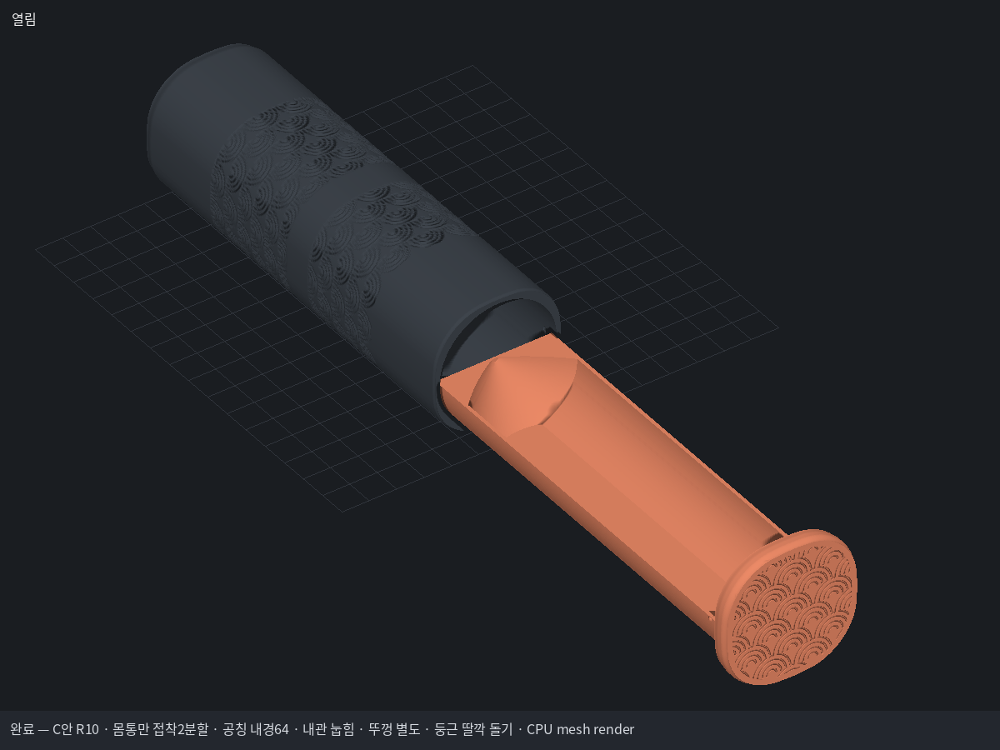
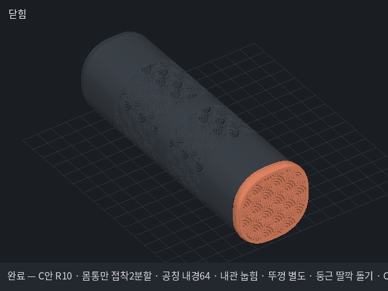

# 셔틀콕 C안 R10 — 공칭 내경64 / 눕힘 내관 / 별도 끼움뚜껑 / 둥근 딸깍

사용자 지정: 열린 반원 받침의 공칭 내경64mm. 깃털의 유연성과 개방된 윗면을 전제로 하며 강체Ø68mm 원통처럼 수납 불가를 단정하지 않는다. 내관 아래를 평평하게 해 눕혀 출력하고 앞 뚜껑은 따로 끼운다. 긴 클립·누름 버튼을 없애고 내관 바깥의 둥근 돌기와 외관 안쪽 홈으로 가볍게 딸깍만 나게 한다. 테슬라·주차판·공용 도구는 수정하지 않는다.

## 설계 치수표

| 항목 | mm | 근거 |
|---|---:|---|
| 내관 공칭 개방 내경 | 64 | 사용자 지정, 실제 메시 단면/레이 검사 |
| 내관 바깥 기준 지름 | 68 | 벽2 유지 |
| 몸통 내경 | 68.6 | 바깥68 + 반경 틈0.30×2 |
| 몸통 폭 / 뚜껑 폭 | 74.6 / 78.6 | 기존 폭에서7.4 감소 |
| 닫힌 전체 길이 / 몸통 길이 | 253 / 243 | R9 유지 |
| 몸통 모서리 / 뚜껑 모서리 | R30 / R32 | 기존 둥근 사각 외형 |
| 몸통 하단 / 상단 높이 | 131.5 / 121.5 | 10mm 접착 턱 포함 |
| 접착 턱 외경 / 소켓 내경 / 겹침 | 71.4 / 72 / 10 | 한쪽 접착 틈0.30 |
| 내관 바닥 외측 / 내측 평면 Y | -32 / -30 | 바닥2 유지 |
| 바닥 평면 폭 | 약22.98 | Ø68 외곽을 Y=-32에서 자른 현 |
| 앞 뚜껑 U형 끼움 길이 / 한쪽 틈 | 6 / 0.20 | 별도 소켓 + 짧은 고정턱2개 |
| 둥근 돌기 반경 / 홈 반경 | 1.6 / 1.85 | 내관 돌기 / 외관 홈 |
| 돌기 통과 공칭 겹침 | 약0.4 | 외측34.7−몸통반경34.3 |
| 콘 입구→끝 경사 / 끝 폭 | 45°→30° / 4 | R9 형상 원리 유지, 출력 방향은 수평으로 변경 |
| 가정한6개 적층 길이 | 225 | 브랜드 실측이 아닌 길이 가정 |

실제 메시 검사·조립 결과는 dimensions.json과 fit_R10.json, 표준 파이프라인 보고서에 기록한다. Ø64 게이지는 바닥 평면 위로2mm 이동한 치수 확인용이다. 깃털 변형·딸깍 작동 힘·뚜껑 유지력·실물 출력은 확인 전이다. 돌기 통과 장면의 압축 메시는 운동학적 간섭 확인용이며 재료 해석 결과가 아니다.

재현은 셔틀콕 전용 보관 도구로 `MM_RENDER_BACKEND=software python tools/mm.py make 작업완료/shuttle6-wave-R10/pipeline_final.json`을 실행한다. 기존 R9을 덮어쓰지 않는다.

앞 뚜껑에는 내관을 당길 때 뚜껑만 빠지지 않도록 내부에 짧은 결합턱2개를 둡니다. 이는 외관과 내관 사이의 둥근 딸깍 돌기와 별개입니다. 눕힌 바닥 양옆의 둥근 전이부는 서포트 대상이며, 완전 무서포트 모델로 표현하지 않습니다.

## 완성본과 AS 자료

- [R10 내경64 눕힘 출력 3MF](deliverables_R10/Shuttle6_C_R10_ID64_horizontal_bambu.3mf)
- [출력자료 ZIP](deliverables_R10/Shuttle6_C_R10_ID64_눕힘내관_별도뚜껑_출력자료.zip)
- [작동 GIF](preview_R10/turntable.gif) · [전체 GIF 목록](AS/GIF_목록.md)
- [내관 단면](drawings/01_ID64_flat_bottom_R10.png) · [둥근 딸깍 단면](drawings/03_detent_detail_R10.png)
- [출력·조립 안내](deliverables_R10/출력_조립_안내.md) · [AS 개정 기록](AS/개정_기록.md)

테슬라·주차판·저장소 공용 도구는 변경하지 않았습니다. 재현 시 AS의 동결 도구 ZIP을 별도 임시 작업 폴더에 풀고 이 프로젝트를 작업완료/shuttle6-wave-R10로 복사해 사용합니다. 저장소의 공용 tools를 덮어쓰지 않습니다. 재생성 가능한 중간 pkl·캐시·브라우저 데이터는 Git에서 제외하고 결과 STL·3MF·PNG·GIF·PDF·검사 JSON/보고서와 소스를 보관합니다.
