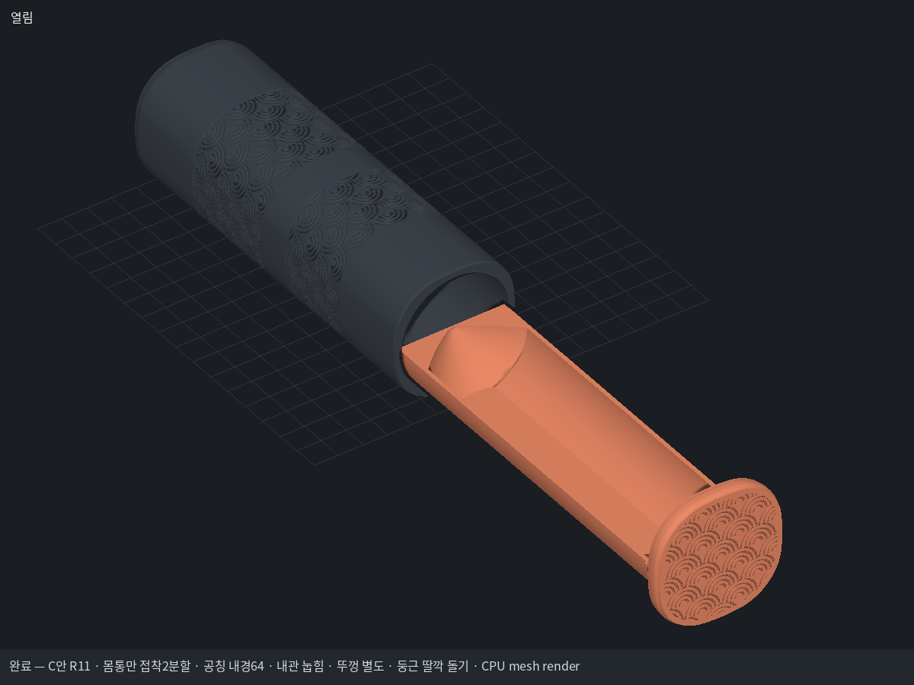
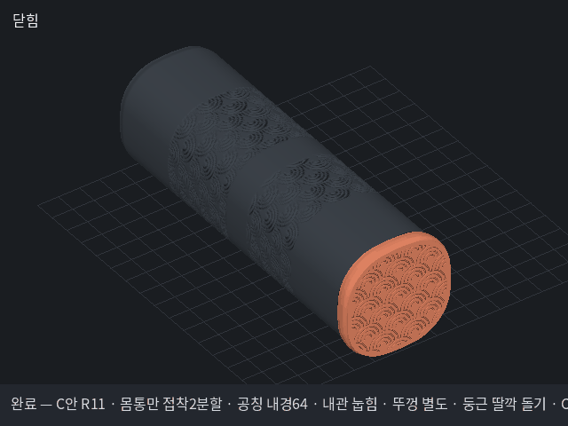

# 셔틀콕 C안 R11 — 공칭 내경64 / 눕힘 내관 / 별도 끼움뚜껑 / 둥근 딸깍

사용자 지정: 열린 반원 받침의 공칭 내경64mm. 깃털의 유연성과 개방된 윗면을 전제로 하며 강체Ø68mm 원통처럼 수납 불가를 단정하지 않는다. 내관 아래를 평평하게 해 눕혀 출력하고 앞 뚜껑은 따로 끼운다. 긴 클립·누름 버튼을 없애고 내관 바깥의 둥근 돌기와 외관 안쪽 홈으로 가볍게 딸깍만 나게 한다. 테슬라·주차판·공용 도구는 수정하지 않는다.

## 설계 치수표

| 항목 | mm | 근거 |
|---|---:|---|
| 내관 공칭 개방 내경 | 64 | 사용자 지정, 실제 메시 단면/레이 검사 |
| 내관 바깥 기준 지름 | 69.2 | 벽2.6: 기존2.0에서0.6 증가 |
| 몸통 내경 | 69.8 | 바깥69.2 + 반경 틈0.30×2 |
| 몸통 폭 / 뚜껑 폭 | 78.2 / 82.2 | 강화 소켓 외벽을 확보한 폭 |
| 닫힌 전체 길이 / 몸통 길이 | 253 / 243 | R9 유지 |
| 몸통 모서리 / 뚜껑 모서리 | R30 / R32 | 기존 둥근 사각 외형 |
| 몸통 하단 / 상단 높이 | 135.5 / 121.5 | 14mm 접착 턱 포함 |
| 접착 턱 외경 / 소켓 내경 / 겹침 | 74.2 / 74.5 / 14 | 한쪽 접착 틈0.15 / 턱 벽2.2 |
| 내관 바닥 외측 / 내측 평면 Y | -32.6 / -30 | 바닥2.6 / 내부면 유지 |
| 바닥 평면 폭 | 약23.19 | Ø69.2 외곽을 Y=-32.6에서 자른 현 |
| 접착부 돌출 키 / 대응 홈 | 폭8 / 옆틈0.10 | 45° 한 곳, 한 방향 정렬 / 어깨턱 면접촉 |
| 앞 뚜껑 U형 끼움 길이 / 한쪽 틈 | 6 / 0.20 | 별도 소켓 + 짧은 고정턱2개 |
| 둥근 돌기 반경 / 홈 반경 | 1.6 / 1.85 | 내관 돌기 / 외관 홈 |
| 돌기 통과 공칭 겹침 | 약0.4 | 외측35.3−몸통반경34.9 |
| 콘 입구→끝 경사 / 끝 폭 | 45°→30° / 4 | R9 형상 원리 유지, 출력 방향은 수평으로 변경 |
| 가정한6개 적층 길이 | 225 | 브랜드 실측이 아닌 길이 가정 |

실제 메시 검사·조립 결과는 dimensions.json과 fit_R11.json, 표준 파이프라인 보고서에 기록한다. Ø64 게이지는 바닥 평면 위로2mm 이동한 치수 확인용이다. 깃털 변형·딸깍 작동 힘·뚜껑 유지력·실물 출력은 확인 전이다. 돌기 통과 장면의 압축 메시는 운동학적 간섭 확인용이며 재료 해석 결과가 아니다.

재현은 셔틀콕 전용 보관 도구로 `MM_RENDER_BACKEND=software python tools/mm.py make 작업완료/shuttle6-wave-R11/pipeline_final.json`을 실행한다. 기존 R10을 덮어쓰지 않는다.

앞 뚜껑에는 내관을 당길 때 뚜껑만 빠지지 않도록 내부에 짧은 결합턱2개를 둡니다. 이는 외관과 내관 사이의 둥근 딸깍 돌기와 별개입니다. 눕힌 바닥 양옆의 둥근 전이부는 서포트 대상이며, 완전 무서포트 모델로 표현하지 않습니다.

## R11 보강

내관 벽·바닥2.0→2.6mm, 내관의 내부 윤곽과 수납Ø64는 유지. 외관 접착부는 단순 원통에서 돌출 키와 맞춤 홈이 있는 이음으로 변경. 끼움턱 벽1.4→2.2mm, 길이10→14mm, 틈0.30→0.15mm/쪽. 키는 폭8mm·높이0.8mm이며45° 한 곳에 두어 조립 방향을 고정한다. 외관 어깨턱은 최종 삽입 위치에서 맞닿는다. 실제 출력 공차와 접착 후 강도는 출력 전이다.

## 완성본과 AS 자료

- [R11 내경64 눕힘 출력 3MF](deliverables_R11/Shuttle6_C_R11_ID64_horizontal_bambu.3mf)
- [출력자료 ZIP](deliverables_R11/Shuttle6_C_R11_ID64_눕힘내관_별도뚜껑_출력자료.zip)
- [작동 GIF](preview_R11/turntable.gif) · [전체 GIF 목록](AS/GIF_목록.md)
- [키·홈 조립 확대 GIF](preview_joint_R11/turntable.gif)
- [키·홈 접착부 단면](drawings/05_keyed_glue_joint_R11.png)
- [내관 단면](drawings/01_ID64_flat_bottom_R11.png) · [둥근 딸깍 단면](drawings/03_detent_detail_R11.png)
- [출력·조립 안내](deliverables_R11/출력_조립_안내.md) · [AS 개정 기록](AS/개정_기록.md)

테슬라·주차판·저장소 공용 도구는 변경하지 않았습니다. 재현 시 AS의 동결 도구 ZIP을 별도 임시 작업 폴더에 풀고 이 프로젝트를 작업완료/shuttle6-wave-R11로 복사해 사용합니다. 저장소의 공용 tools를 덮어쓰지 않습니다. 재생성 가능한 중간 pkl·캐시·브라우저 데이터는 Git에서 제외하고 결과 STL·3MF·PNG·GIF·PDF·검사 JSON/보고서와 소스를 보관합니다.

## R11 실제 출력 방향 QC

|파트|삼각형|닫힌 단일 조각|얇은 특징 mm²|지지 대상 누적 mm²|최대 브리지 mm|
|---|---:|---|---:|---:|---:|
|shell_lower|64520|True|5.2|0.0|0.0|
|shell_upper|49012|True|0.0|0.0|4.9|
|drawer|39190|True|0.0|4610.4|0.0|
|cap|110274|True|0.0|0.0|2.9|
|shell_coupon|4146|True|0.0|0.0|0.0|
|drawer_coupon|1580|True|0.0|713.1|0.0|
|tip_coupon|16460|True|0.0|180.0|0.0|

shell_lower의5.2mm²는 z135.2 키 선단 삽입 유도 모서리입니다. 연속 몸통 벽이 아닌 국부 형상으로 위치·면적·허용 근거를 검사 보고서에 남겼습니다. 내관 하부 곡면은 트리서포트 대상입니다.
실제 조립 간섭0mm³, 키는 ±0.5° 비틀림에서2.67mm³의 의도한 걸림을 보입니다. 이는 형상상 회전 제한의 증거이며 실물 토크·접착 강도 측정은 아닙니다.
