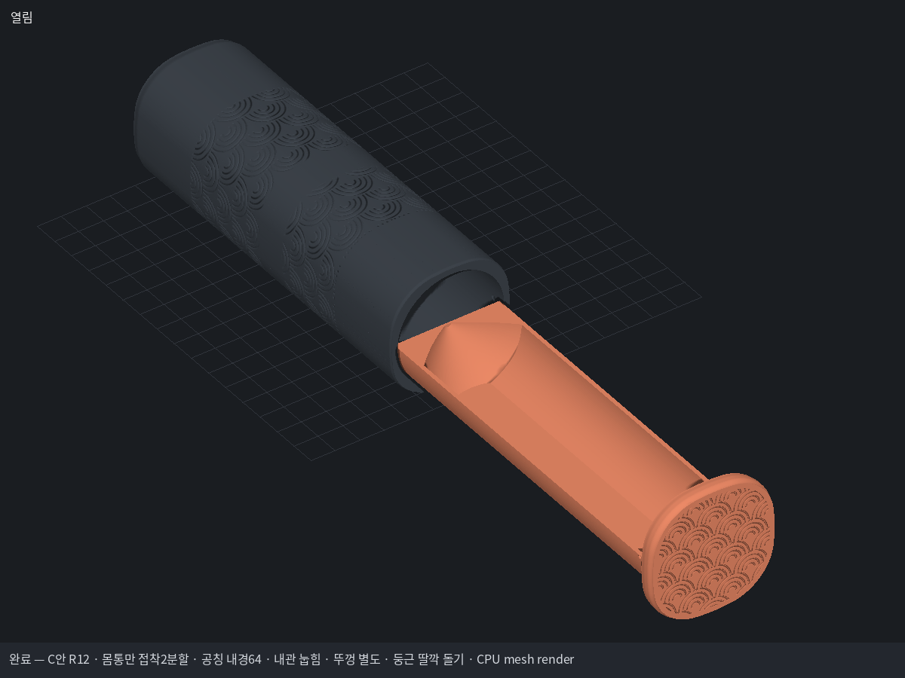
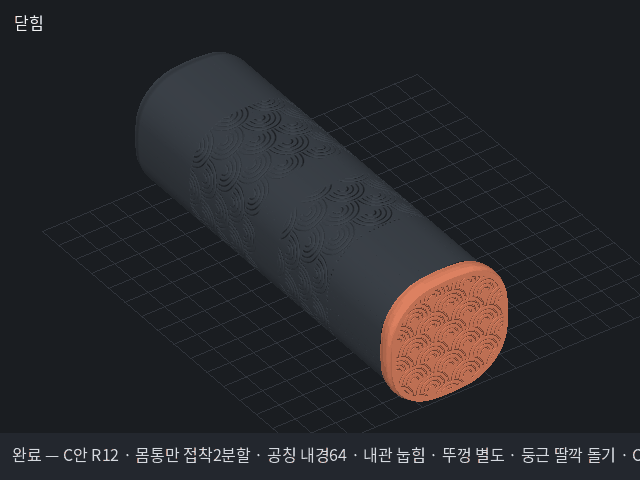

# 셔틀콕 C안 R12 — 최종 요구사항 통합 / 매끄러운 문양

[최종 요구사항 전체](요구사항_최종정리.md).6개 수납 목표·수납 내경64·2.6mm 내관·눕힘 출력·별도 뚜껑·몸통만2분할·튼튼한 키/홈 접착부·가벼운 둥근 딸깍·연속 곡면 콘·개선된4중 겹반원을 통합했습니다.

## 설계 치수표

|항목|mm|근거|
|---|---:|---|
|수납 공칭 내경|64|사용자 지정, 실제 내관 단면 검사|
|내관 벽 / 바닥|2.6 / 2.6|기존2.0에서 외측 보강|
|내관 외측 지름|69.2|Ø64+2×2.6|
|외관 내경 / 슬라이드 반경 틈|69.8 /0.30|내관 상대면에서 측정|
|외관 폭 / 뚜껑 폭|78.2 /82.2|R11 보강 외형 유지|
|닫힌 길이 / 몸통 길이|253 /243|기존 사용 길이 유지|
|몸통 모서리 / 옆면|R30 /R100|두 곡률 접선 연결|
|분할 하단 / 상단 출력 높이|135.5 /121.5|14mm 접착 중첩|
|접착 턱 외경 / 소켓 내경|74.2 /74.5|반경 틈0.15|
|접착턱 벽 / 겹침 길이|2.2 /14|R11 보강부 유지|
|회전 방지 키 폭 / 높이|8 /0.8|45° 한 곳, 옆면 틈0.10|
|내관 바닥 외측 / 내측 Y|-32.6 /-30|바닥2.6|
|평평한 바닥 폭|약23.19|외측 원의 현|
|뚜껑 반원 전체 포켓 깊이 / 한쪽 틈|4 /0.20|속이 찬 반원 끼움부3.8mm + 사각 딸깍 키|
|뚜껑 안쪽 사각 포켓 한 변 / 추가 깊이|30 /3|대응 사각 키29.6, 탄성 걸림턱2개|
|둥근 돌기 / 대응 홈 반경|1.6 /1.85|외부 돌기와 내부 홈|
|딸깍 통과 반경 겹침|약0.4|탄성 통과 의도값, 실물 힘 아님|
|콘 입구→끝 접선 / 끝 폭|45°→30° /4|전체 사면 즉시 곡률|
|끝 벽 두께|1.25|콘 외부 채움|
|가정6개 적층 길이|225|브랜드 실측 아님|
|외관 문양 주기 / 홈 폭 / 깊이|25.725 /1.6 /0.4|최종 비교안|
|동심원호 사이 평탄폭|약1.358|좁은0.065mm 표면 능선 개선|

최종 조립·단면 수치는 dimensions.json / fit_R12.json과 QC 보고서에 기록합니다. 수납 게이지는Ø64 치수 확인용이고 깃털 재료 변형을 해석한 것은 아닙니다. 돌기 압축 장면은 운동학적 간섭 확인용이며 실제 힘·토크·접착 강도는 출력 시험 전입니다. 내관 하부 전이부는 트리 지지 대상이며 완전 무서포트 모델로 표시하지 않습니다.

## 완성 파일

- [통합 Bambu3MF](deliverables_R12/Shuttle6_C_R12_ID64_horizontal_bambu.3mf)
- [출력자료 ZIP](deliverables_R12/Shuttle6_C_R12_ID64_눕힘내관_별도뚜껑_출력자료.zip)
- [작동 GIF](preview_R12/turntable.gif) · [전체 GIF 목록](AS/GIF_목록.md)
- [반원·30mm 사각 키 결합 GIF](preview_cap_R12/turntable.gif)
- [키·홈 조립 GIF](preview_joint_R12/turntable.gif) · [접착부 단면](drawings/05_keyed_glue_joint_R12.png)
- [출력·조립 안내](deliverables_R12/출력_조립_안내.md) · [AS 개정 기록](AS/개정_기록.md)

재현: AS의 동결 도구ZIP을 별도 폴더에 풀고 이 프로젝트를 작업완료/shuttle6-wave-R12에 둔 뒤 `MM_RENDER_BACKEND=software python tools/mm.py make 작업완료/shuttle6-wave-R12/pipeline_final.json`. 공용tools는 덮어쓰지 않습니다. 원본 Bambu메타데이터 구조·설정·좌표와 표준형상 사본 strict 검사는 구분하며 실물 GUI/슬라이싱은 확인 전입니다.

## 실제 출력 방향 QC

|파트|삼각형|닫힌 단일 조각|얇은 특징 mm²|지지 대상 누적 mm²|최대 브리지 mm|
|---|---:|---|---:|---:|---:|
|shell_lower|152766|True|5.2|0.0|0.0|
|shell_upper|126702|True|0.0|0.0|4.9|
|drawer|39072|True|0.0|4652.0|3.3|
|cap|109904|True|0.0|0.0|1.9|
|shell_coupon|4146|True|0.0|0.0|0.0|
|drawer_coupon|1646|True|0.0|754.8|3.3|
|tip_coupon|16460|True|0.0|180.0|0.0|

하부 키 선단의 유도 모서리5.2mm²는 위치z135.2와 허용 근거를 보고서에 기록했습니다. 연속 벽은 최소1.85mm·축부2.2mm이며 독립된 얇은 벽이 아닙니다. 내관/시험편 하부 전이부는 트리서포트 대상입니다.
사각 스냅 통과는 변형 메시에 의한 운동학 검증이며, 선형 보 계산과 함께 실제 출력 유지력·피로 시험을 대신하지 않습니다.
