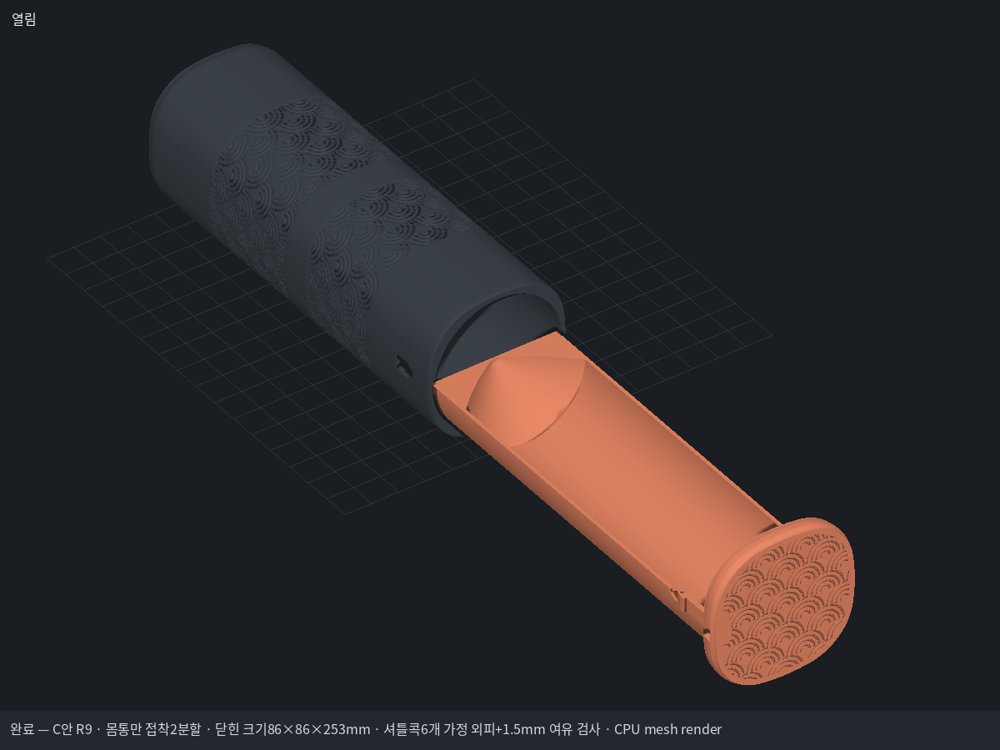
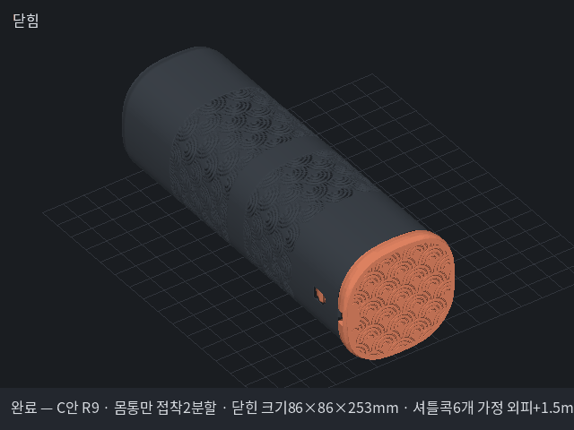

# 셔틀콕 C안 R9 — 둥근 콘 홈과 외부 채움 / 몸통2분할

사용자 최종 지시: 6개용, 세워서 감속 출력, 몸통만 두 조각으로 잘라 접착. 받침과 뚜껑은 일체형이며 끝 홈은 셔틀콕에 여유를 주고 마지막을 짧은 브리지로 닫는다. R30 외형과 C안 문양은 보존한다. 별도 3MF 허락을 다시 묻지 않고 전달한다.

## 설계 치수표

| 설계 항목 | mm |
|---|---:|
| 조립 몸통 길이 / 닫힌 전체 | 243 / 253 |
| 몸통 폭 / 뚜껑 폭 | 82 / 86 |
| 몸통 모서리 / 뚜껑 모서리 | R30 / R32 |
| 몸통 하단 출력 높이 / 상단 출력 높이 | 131.5 / 121.5 |
| 접착 턱 겹침 / 외경 / 내경 | 10 / 78.8 / 76 |
| 상단 소켓 내경에서 산출한 접착 반경 틈 | (79.4−78.8)/2 = 0.30 |
| 반원 받침 외경 / 내경 | 75.4 / 71.4 |
| 받침 출력 높이 | 249.8 |
| 가정6개 적층 길이 / 깃털 최대지름 / 코르크 지름 | 225 / 68 / 28 |
| 수납 여유 외피 오프셋(앞면 지지 접촉 제외) | 1.5 |
| 콘 주 경사→끝 경사(베드 기준) / 곡선 전이 길이 / 끝 라운드 | 45°→30° / 전체 사면 즉시 곡률 / 약R162.72 |
| 마지막 브리지 / 곡면 시작 개구 / 천장 최소두께 | 4.000 / 71.4 / 1.250 |
| 스프링 길이 / 두께 / 폭 / 누름 | 30.5 / 3 / 8 / 1.5 |

모든 브랜드의6개 적층 길이가225mm 이하라는 뜻이 아니다. 셔틀콕 형상은 검증용 가정 외피로 작성하며 실물 시험은 하지 않았다. 잠금부 시험편을 먼저 출력하고 몸통은 접착 전에 가조립한다. 접착제는 끼움 턱 외측에만 소량 바르고 내부에 흘리지 않는다.

재현: `python tools/mm.py make 작업완료/shuttle6-wave-R9/pipeline_final.json`. 최초 실행에는 형상 QC·조립·렌더 단계가 먼저 자동 실행된다. 소프트웨어 렌더 환경은 `MM_RENDER_BACKEND=software`.

낮은 전역 속도·가속도를 실제 템플릿 키로 기록한다. 높이별 modifier는 만들지 않았으므로 높이별 자동 감속으로 주장하지 않는다. Bambu Studio 실제 GUI·G-code·출력시간·실물 내구는 확인 전이다.

R9: 입구45도에서 바로 원호 곡률을 시작해 끝30도(베드 기준)까지 연속으로 완만해집니다. 직선 사면이나 끝부분만 둥글리는 지연 구간은 없습니다. 개구 폭4.000mm에서 곡면을 끝내고 브리지로 닫습니다. 천장1.25mm·받침높이249.8mm·외부 채움·몸통2분할을 유지합니다. 05는 끝9.8mm 시험편이며 전체 사면의 무서포트 출력 시험편은 아닙니다. 수정형상으로 수납 여유 및 오버행을 재검사합니다.

## 완성본 보관 · AS 준비

2026-10-21 사용자 지시에 따라 R9을 작업완료로 옮겼습니다. 완성 보관은 실물 출력 검증을 추가로 의미하지 않습니다. 기존 3MF와 STL·메시·도면·검사 결과는 보존하고 문서의 보관 위치만 갱신했습니다.

- [출력용 3MF](deliverables_R9/Shuttle6_C_R9_split_body_P1S_bambu.3mf) · [출력자료 ZIP](deliverables_R9/Shuttle6_C_R9_몸통접착_출력자료.zip)
- [전체 작동 GIF](preview_R9/turntable.gif) · [콘 수정 전후 GIF](preview_cone_R9/turntable.gif)
- [최종 조립 GIF](qc/final_R9/assembly/turntable.gif) · [플레이트 GIF 전체 목록](AS/GIF_목록.md)
- [AS 준비와 크기 피드백](AS/README.md) · [이동 전 원본 해시](AS/R9_보존목록.json)

공용 도구와 테슬라·주차판 파일은 이번 업로드에서 변경하지 않았습니다. R9 당시 도구·템플릿은 `AS/R9_재현도구_원본.zip`에 별도 보관했습니다(AS 문서에서는 `R9_재현도구_원본.zip`). 재현 시 원본 저장소를 직접 바꾸지 말고 임시 저장소에 이 ZIP을 풀고 이 프로젝트를 작업완료/shuttle6-wave-R9에 복사한 후 해당 tools/mm.py를 사용합니다.
